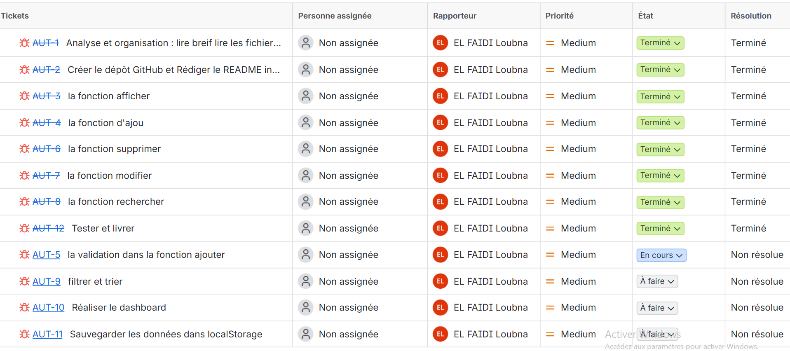

# AutoPark — Atlas Auto

Application web de gestion de parc automobile pour **Atlas Auto**, une agence fictive de location de voitures. Elle permet de consulter les véhicules, de modifier leurs informations et leurs tarifs, et de suivre leur disponibilité.

L'application fonctionne **sans backend ni base de données** : les données sont sauvegardées dans le navigateur grâce à `localStorage`.

🔗 **Application déployée :** [lien-de-deploiement](https://exemple.github.io/autopark/)
📦 **Dépôt GitHub :** [lien-du-depot](https://github.com/utilisateur/autopark)

---

## Sommaire

- [Aperçu](#aperçu)
- [Technologies](#technologies)
- [Fonctionnalités](#fonctionnalités)
- [Structure des fichiers](#structure-des-fichiers)
- [Lancer le projet en local](#lancer-le-projet-en-local)
- [Modèle de données](#modèle-de-données)
- [Organisation du code](#organisation-du-code)
- [Règles de validation](#règles-de-validation)
- [Gestion de projet](#gestion-de-projet)
- [Auteur](#auteur)

---

## Aperçu

L'application se compose de deux pages :

| Page | Fichier | Rôle |
|---|---|---|
| **Gestion du parc** | `voitures.html` | Ajouter, modifier, supprimer, rechercher, filtrer et trier les voitures |
| **Dashboard** | `index.html` | Afficher les indicateurs du parc (total, disponibles, louées, en maintenance) |

Les deux pages partagent les **mêmes données** via `localStorage`.

---

## Technologies

- **HTML5** (sémantique et accessibilité)
- **CSS3** (fichiers externes, design responsive)
- **JavaScript Vanilla ES6+** (modules, fonctions fléchées, template literals, déstructuration, spread/rest)
- **localStorage**, `JSON.stringify()` et `JSON.parse()` pour la persistance
- **Git / GitHub** pour le versionnement
- **Jira** pour le suivi des tâches

Aucun framework JavaScript, aucun backend, aucune base de données et aucune API externe n'est utilisé.

---

## Fonctionnalités

### Gestion du parc (`voitures.html`)

- **Affichage dynamique** des voitures dans un tableau HTML, avec une couleur différente selon le statut.
- **Message d'état vide** lorsque le parc ne contient aucune voiture.
- **Ajout** d'une voiture via un formulaire, sans rechargement de la page, avec confirmation et réinitialisation du formulaire.
- **Modification** : le bouton « Modifier » préremplit le formulaire. L'identifiant de la voiture ne change pas et aucun doublon n'est créé. Un bouton « Annuler » permet de quitter le mode modification.
- **Suppression** avec demande de confirmation. Si l'utilisateur annule, les données sont conservées.
- **Recherche instantanée** par marque, modèle ou immatriculation (insensible à la casse).
- **Filtres** par catégorie et par statut.
- **Tri numérique** par prix croissant ou décroissant.
- **Réinitialisation** de tous les critères de recherche, de filtre et de tri.
- Tous les critères fonctionnent **simultanément**, avec un message lorsqu'aucun résultat ne correspond.

### Dashboard (`index.html`)

- En-tête AutoPark et navigation entre les deux pages.
- **Quatre compteurs** : Total, Disponibles, Louées, En maintenance.
- Indicateurs calculés à partir des données enregistrées et mis à jour à chaque ouverture ou rechargement, y compris lorsque le parc est vide.
- Interface responsive (mobile, tablette, desktop), cohérente avec la page de gestion.

### Persistance

- Sauvegarde dans `localStorage` après chaque ajout, modification ou suppression.
- Au chargement, les données sauvegardées sont récupérées. Les données initiales ne sont utilisées que si **aucune sauvegarde n'existe** : un parc volontairement vidé reste vide.

---

## Structure des fichiers

> Adapte cette arborescence aux noms réels de tes fichiers.

```
autopark/
├── index.html              # Dashboard
├── voitures.html           # Gestion du parc
├── css/
│   ├── style.css           # Styles communs
│   └── dashboard.css       # Styles du dashboard
├── js/
│   ├── data.js             # Données initiales
│   ├── storage.js          # Lecture / écriture dans localStorage
│   ├── voitures.js         # Logique du parc (CRUD, validation, recherche, tri)
│   ├── ui.js               # Affichage et manipulation du DOM
│   └── dashboard.js        # Calcul et affichage des compteurs
├── images/
│   └── jira.png            # Capture du tableau Jira
└── README.md
```

---

## Lancer le projet en local

Le projet utilise les **modules ES6** (`import` / `export`). Il doit donc être exécuté avec un **serveur local** : l'ouverture directe du fichier HTML (`file://`) ne fonctionne pas.

1. **Cloner le dépôt**

   ```bash
   git clone https://github.com/utilisateur/autopark.git
   cd autopark
   ```

2. **Lancer un serveur local**, au choix :

   - Avec l'extension **Live Server** de VS Code : clic droit sur `index.html` puis « Open with Live Server ».
   - Avec Node.js :

     ```bash
     npx serve .
     ```

   - Avec Python :

     ```bash
     python -m http.server 8000
     ```

3. **Ouvrir le navigateur** à l'adresse indiquée (par exemple `http://localhost:8000`).

---

## Modèle de données

Chaque voiture est un objet :

```js
{
  id: 1,                      // identifiant unique généré automatiquement
  marque: "Dacia",
  modele: "Sandero",
  immatriculation: "AUTO-007", // unique
  categorie: "Citadine",       // Citadine | Berline | SUV
  prixJour: 250,               // strictement positif, en dirhams (DH)
  statut: "Disponible"         // Disponible | Louée | En maintenance
}
```

---

## Organisation du code

Le code est organisé en **modules ES6**, chacun avec une responsabilité claire :

| Module | Responsabilité |
|---|---|
| Données | Fournit le jeu de données initial |
| Stockage | Charge et sauvegarde le tableau dans `localStorage` |
| Logique métier | Ajout, modification, suppression, validation, recherche, filtres, tri |
| Affichage | Génère le tableau, les messages d'erreur et l'état vide |
| Dashboard | Calcule et affiche les compteurs à partir des données sauvegardées |

Les fonctions communes aux deux pages (par exemple le chargement des données) sont **réutilisées** et non dupliquées.

### Méthodes de tableaux utilisées

| Méthode | Utilisation |
|---|---|
| `map()` | Mise à jour d'une voiture, génération des lignes du tableau |
| `filter()` | Suppression, filtres par catégorie et statut, recherche |
| `find()` | Retrouver une voiture à partir de son identifiant |
| `some()` | Détection des immatriculations en doublon |
| `reduce()` | Calcul des compteurs du dashboard |

### Principe de la modification

Le formulaire sert à la fois à l'ajout et à la modification. Un champ caché `champId` mémorise le mode :

- **vide** : le formulaire est en mode ajout ;
- **rempli** : le formulaire est en mode modification de la voiture portant cet identifiant.

---

## Règles de validation

- Tous les champs sont obligatoires, et les champs ne contenant que des espaces sont refusés.
- Le prix par jour doit être **strictement positif**.
- L'immatriculation doit être **unique**, sans tenir compte de la casse ni des espaces autour.
- Lors d'une modification, une voiture peut **conserver sa propre immatriculation**.
- Les messages d'erreur s'affichent **près des champs concernés**.

---

## Gestion de projet

- **Jira** : les tâches (AUT-1 à AUT-12) et leur état d'avancement sont suivis dans le tableau Jira du projet.
- **GitHub** : historique de commits significatifs et Pull Requests documentées.

### Tableau Jira



---

## Périmètre

Hors périmètre : authentification, gestion des clients, contrats, réservations par dates et paiements. Le statut « Louée » est défini manuellement.

---

## Auteur

Projet réalisé dans le cadre d'un travail individuel, du 26 au 30 octobre 2026.

**[Ton nom]**